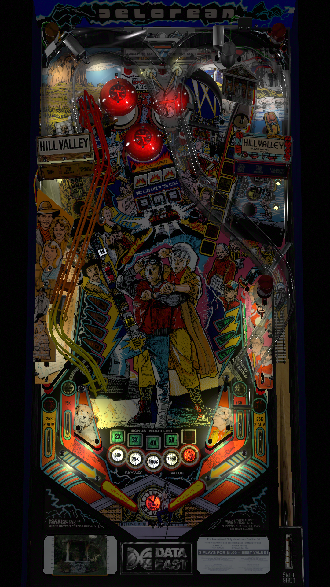

# Basic Cab

The simplest theme for a cabinet.  The playfield screen shows the table you are on, full screen, with nothing drawn over it.  Move the wheel and the picture changes, press select and the table starts.

The picture is the table's playfield video or image, whichever Playfield Media Priority in VPinFE's settings asks for.  A table with only one of them shows that one, and a table with neither shows its name in the middle of the screen.  When a cabinet mounts the screen sideways, the picture is turned to fill it.

The backglass and score view screens are VPinFE's own: the table's backglass or score view art, full screen.

## Install

Open Themes in the Console, find Basic Cab, and press Install.  Then press Make Active and restart VPinFE.  It needs VPinFE 3.0 or later.
